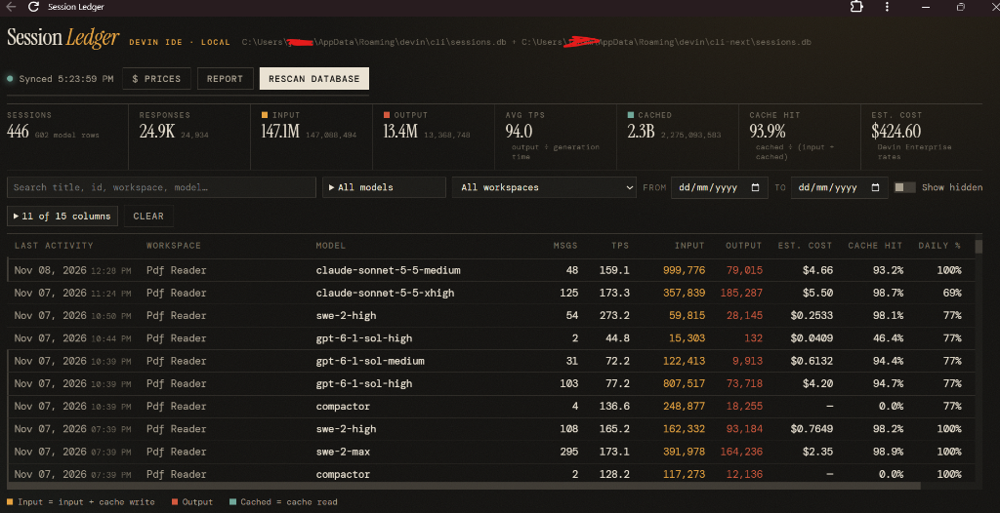

# Session Ledger

A local, read-only dashboard for token usage across your Devin IDE sessions.
It reads the Devin `sessions.db` files directly from your machine — both the
CLI's (`%APPDATA%\devin\cli`) and the IDE's (`%APPDATA%\devin\cli-next`) when
present — aggregates token metrics per session and model, estimates cost at
published rates, and serves a single-page dashboard on `127.0.0.1`.
Your session data never leaves your machine.



## Requirements

- Windows (`run.bat` / `stop_server.bat`; macOS/Linux users see below)
- Python 3.8+ on PATH — **no pip installs**, stdlib only
- The Devin CLI / Devin Desktop installed, so a `sessions.db` exists under
  `%APPDATA%\devin\cli` or `%APPDATA%\devin\cli-next`
- Node.js — only needed to run the unit tests, not the dashboard

## Run

```bat
run.bat
```

Starts `python server.py` on http://127.0.0.1:8765 and opens the dashboard.
If you've installed it as a web app (PWA), the app window opens instead of a
browser tab; otherwise your default browser is used. `DASHBOARD_APP` overrides
the shortcut/exe to launch, and `DASHBOARD_APP=browser` forces the browser.
Use `run.bat --no-browser` to skip opening it entirely.

Stop it with `stop_server.bat` (kills the `server.py` process on the port) or
Ctrl+C in the server window. The server also exits on its own ~90s after the
dashboard tab/window closes — the page pings the server every 20s and it shuts
down once pings stop (`--no-browser` keeps it running).

### macOS / Linux

The batch files are Windows-only, but the server itself is portable:

```sh
SESSIONS_DB=/path/to/sessions.db python server.py
```

`SESSIONS_DB` is required there because the default paths use `%APPDATA%`.
It accepts several paths joined by `os.pathsep` (`;` on Windows, `:` elsewhere).

## Using the dashboard

- One row per **(session, model)**. Sessions with no metrics show a single empty row.
- **Input** = input tokens + cache-write tokens. **Cached** = cache-read tokens.
- **TPS** = output tokens ÷ generation time, token-weighted; shown as a column
  and an "Avg TPS" totals card (also in session details and reports).
- Forked branches duplicate assistant responses; they're deduplicated by `request_id`.
- Filter by search text, model (multi-select), workspace, and date range.
  Toggle "Show hidden" to include hidden sessions. Click column headers to sort.
  The **Source** column shows which database a session came from (`cli` vs
  `cli-next`); hide it via the Columns picker.
- Filter/sort state is kept in the URL hash, so a filtered view survives
  reloads and can be bookmarked.
- **Daily % / Weekly %** show the account quota remaining at each session's
  last activity, sampled from the Devin `GetUserStatus` endpoint (the same call
  the CLI's `/usage` panel makes). A value is only valid until that sample's
  reset; past it the cell shows `—`. Percent fields only exist on quota-billed
  plans.
- **Double-click a row** (or focus it and press Enter) for full session details
  across all models, regardless of table filters.
- **$ Prices** shows the rate card; **Rescan database** re-reads `sessions.db`
  (only sessions whose `last_activity_at` changed are re-aggregated).
- **Report** opens the report maker: Excel-style model checkboxes (all included
  by default, uncheck to exclude), a response-date range, and grouping by
  model, workspace, day, week, or month. Time-period groups show a stacked
  usage-over-time chart (Cost/Tokens toggle; top 7 models colored, rest folded
  into "other"); a View toggle swaps it for the sortable list. Results are
  exportable to CSV. **Allowance value** estimates the weekly/monthly dollar
  value of your quota from drops between consecutive quota samples.

## Configuration

| Env var          | Default                                                    | Purpose                              |
|------------------|------------------------------------------------------------|--------------------------------------|
| `SESSIONS_DB`    | `%APPDATA%\devin\cli\sessions.db` and `...\cli-next\…`     | Database paths (`os.pathsep`-joined) |
| `DASHBOARD_PORT` | `8765`                                                     | Port to listen on                    |
| `DASHBOARD_APP`  | installed "Session Ledger" web app, else browser           | App/browser to open; `browser` forces a browser tab |

Each configured database that exists is scanned; sessions are tagged with a
**Source** label taken from the database's parent folder. Aggregates are cached
in `.cache/sessions_cache.json`, keyed by `source:session-id` and each session's
`last_activity_at`, so rescans are incremental.

## Pricing

Estimated costs use the published rates from
[docs.devin.ai/desktop/models](https://docs.devin.ai/desktop/models)
(Enterprise SaaS tier, Pro-tier fallback), stored in `pricing_data.json`.

- `update_prices.bat` fetches the latest rates, prints a diff, and rewrites
  `pricing_data.json`. The file is hot-reloaded on change — no restart needed.
  `python update_prices.py --dry-run` previews changes without writing;
  `--file page.html` parses a saved copy of the page instead of fetching.
- `pricing_manual.json` holds hand-entered rates for models Devin doesn't
  publish. It's never overwritten by the updater, and it can define
  `long_prompt` rates for requests whose prompt exceeds 100K tokens.
- Models with no matching rate (e.g. summarizer/compactor models) show `—`
  instead of a price.

## Tests

```bat
python -m unittest test_server
```

Uses a mocked DOM via Node.js for the front-end logic tests; no browser needed.

## Project layout

```
server.py            HTTP server + sqlite aggregation + cache
pricing.py           Rate lookup, model-slug resolution, hot-reload
pricing_data.json    Published rates (written by update_prices.py)
pricing_manual.json  Hand-entered rates (never auto-overwritten)
update_prices.py     Fetches + parses the docs.devin.ai rate card
static/              Single-page dashboard (index.html, app.js, style.css)
run.bat / stop_server.bat / update_prices.bat   Windows helpers
test_server.py       Unit tests
```

## Privacy

The server binds `127.0.0.1` only and opens `sessions.db` read-only. While the
dashboard is open it polls the Devin `GetUserStatus` endpoint (every ~5 min)
to fill the quota columns, using the API key in
`%APPDATA%\devin\credentials.toml` — the key is sent only to Devin's own API
and never leaves the server otherwise. The only other outbound call is
`update_prices.py` fetching the public pricing page. Your session data stays
in `%APPDATA%` and is never copied into this repo.

## License

[MIT](LICENSE)
